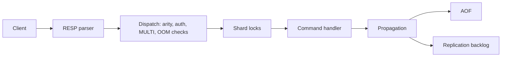
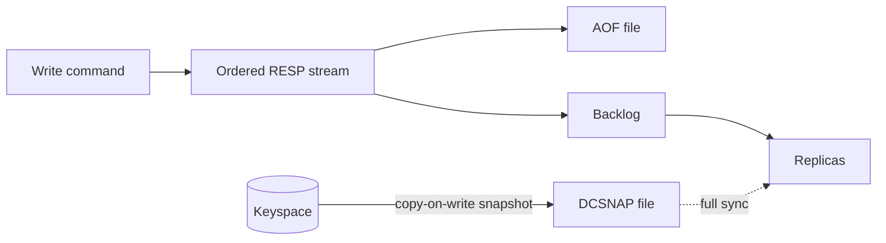

<p align="center"></p>

# DistCache

DistCache is a Redis-compatible in-memory server written in Go. It targets Redis 8.4 command semantics and replies, uses only the Go standard library (including its own Lua 5.1 interpreter), and runs on Linux and macOS, with Windows as a preview. Unlike Redis, which executes commands on one thread, DistCache executes them concurrently across a sharded keyspace so a single node can use every core. Any Redis client should work unchanged.

| Read this | For |
|---|---|
| [docs/features.md](docs/features.md) | Everything the server does, with its status |
| [docs/commands.md](docs/commands.md) | All 247 commands |
| [docs/redis-compatibility.md](docs/redis-compatibility.md) | What differs from Redis 8.4 and what is missing |
| [docs/benchmarks.md](docs/benchmarks.md) | Measured performance against Redis 8.4 |
| [docs/guides/03-deployment.md](docs/guides/03-deployment.md) | Installing on Linux, macOS, Windows, Docker and Kubernetes |
| [docs/guides/01-manual-testing.md](docs/guides/01-manual-testing.md) | Trying each feature by hand |
| [docs/architecture.md](docs/architecture.md) | How it works, end to end |
| [docs/code-review-2026-11-23.md](docs/code-review-2026-11-23.md) | The latest full code review and its open items |

## Status

| Area | Status |
|---|---|
| Strings, lists, hashes (incl. field TTL), sets, sorted sets, streams, bitmaps, HyperLogLog, geo | Implemented (247 commands registered) |
| RESP2 and RESP3, pipelining, pub/sub, sharded pub/sub, MULTI/EXEC/WATCH, blocking commands | Implemented |
| Lua scripting (EVAL, EVALSHA, SCRIPT) and FUNCTIONs on a built-in Lua 5.1 interpreter | Implemented |
| TTL, eviction (LRU, LFU, random, TTL), keyspace notifications | Implemented |
| Persistence: snapshots (SAVE/BGSAVE) and AOF | Implemented, custom format (not RDB) |
| Replication with PSYNC-style partial resync, WAIT, WAITAOF | Implemented |
| Protected mode, protected configs, `enable-debug-command`, limits before `AUTH` | Implemented, with Redis's defaults |
| ACL | Partial: a single `default` user backed by `requirepass` |
| LATENCY, MODULE | Partial: canned replies |
| Release archives (Linux, macOS, Windows), container image, Compose, Kubernetes manifests, systemd unit | Implemented; Windows is a preview |
| Web console (login, dashboard, command console) | Built under `internal/web`, not started by the server yet |
| Automatic AOF rewrite, `min-replicas-to-write` | Planned |
| Redis 8.x additions (vector sets, JSON, Query Engine, time series, probabilistic types) | Planned, except HGETDEL/HGETEX/HSETEX which exist |
| Redis Cluster-compatible cluster mode, FAILOVER | Planned |
| TLS | Planned |
| Prometheus metrics endpoint | Planned |

## Quick start

Requires Go 1.27.

```sh
make build
./bin/distcache-server --port 6380 --dir /tmp/distcache
```

Or run without building:

```sh
go run ./cmd/distcache-server --port 6380
```

Talk to it with any Redis client, for example `redis-cli`:

```sh
redis-cli -p 6380 PING
redis-cli -p 6380 SET name mehedi
redis-cli -p 6380 GET name
```

Docker (the image listens on 6379, stores data in `/data` and runs as an unprivileged user):

```sh
make docker
docker run --rm -p 127.0.0.1:6379:6379 -v distcache-data:/data distcache:dev
```

Release archives for Linux, macOS and Windows come from `make dist`. Compose, Kubernetes and systemd files are in [deploy/](deploy/); [the deployment guide](docs/guides/03-deployment.md) walks through each.

Like Redis, the server runs with `protected-mode yes`: while no `requirepass` is set it only accepts clients from loopback or a Unix socket and answers others with `-DENIED`. The Docker image passes `--protected-mode no` because the published port is the access control there; set `--requirepass` for anything beyond local use. `dir`, `dbfilename` and `appendfilename` are protected configs: CONFIG SET refuses them unless the server was started with `enable-protected-configs yes` (or `local`, for loopback clients only). `DEBUG` is refused unless the server was started with `enable-debug-command yes` or `local`.

Client examples in Go, Java, Python and Node are in [examples/README.md](examples/README.md). A walkthrough for poking at the server by hand is in [docs/guides/01-manual-testing.md](docs/guides/01-manual-testing.md).

## Configuration

Configuration uses redis.conf syntax and redis-server-style flags:

```sh
./bin/distcache-server /path/to/distcache.conf --maxmemory 2gb --appendonly yes
```

A commented sample is in [deploy/distcache.conf](deploy/distcache.conf). Defaults: port 6379, snapshot file `dump.dcs`, AOF `appendonly.aof`, 256 shards (`--shards`, power of two). Settings are live: `CONFIG GET *` lists every supported parameter, and `CONFIG SET` / `CONFIG REWRITE` work. Unsupported redis.conf directives are accepted and ignored. The legacy `-listenAddr host:port` flag still works.

## Architecture

Request path (one goroutine per connection):



Persistence and replication share one ordered stream of write effects:



Commands lock only the shards their keys hash to (in ascending order), so commands on different keys run in parallel. MULTI/EXEC and scripts hold their locks for their whole duration. The full design, including blocking commands, durability and replication, is in [docs/architecture.md](docs/architecture.md).

## Compatibility

DistCache speaks RESP2 and RESP3 and is compared reply-for-reply against a real Redis 8.4 in differential tests. It implements 247 of Redis 8.4's 259 core commands and none of the 154 module commands (JSON, search, time series, probabilistic types, vector sets). Intentional differences are listed in `testutil.KnownDivergences` ([internal/testutil/differential.go](internal/testutil/differential.go)); bugs found so far are tracked in [internal/server/redis84_divergence_test.go](internal/server/redis84_divergence_test.go). The DCSNAP snapshot format is not RDB: RDB files and DUMP payloads are not interchangeable with Redis, and DistCache replicates only with DistCache. The full comparison is in [docs/redis-compatibility.md](docs/redis-compatibility.md).

## Performance

```sh
make bench                       # DistCache vs redis-server (if on PATH), see scripts/bench.sh
scripts/bench-slow-command.sh    # what one slow command does to the other clients
make microbench                  # Go micro-benchmarks
```

Measured against Redis 8.4.8 on 2026-11-23 (one Docker VM on an Apple M1, single runs, load tool sharing the CPUs):

- Without pipelining, DistCache is 1.1 to 1.5 times faster than Redis in its default configuration on `SET`, `GET`, `INCR`, `LPUSH` and `HSET`.
- With pipelining, and against Redis started with `--io-threads 4`, Redis is faster, by up to about 5 times. `ZADD` is 2 to 3.5 times faster on Redis in every test.
- While one client runs a long command, Redis serves the others at about 1,000 `GET`s per second because it runs one command at a time. DistCache locks only that command's shards and keeps serving about 186,000.

So DistCache is not faster than Redis overall yet; its advantage today is that clients do not stall each other. [docs/benchmarks.md](docs/benchmarks.md) has every number, the method and the planned work on throughput.

## Testing

```sh
make test       # unit and integration tests with -race
make test-e2e   # end-to-end tests (separate module in test/e2e)
make test-all
```

Differential tests start a real `redis-server` if one is on PATH; set `DISTCACHE_SKIP_REDIS=1` to skip them. `internal/testutil` boots in-process servers for tests.

## Project layout

```
cmd/            distcache-server, distcache-bench
internal/       config, logger, resp, server, storage, ds, lua, web, testutil
examples/       client examples (Go, Java, Python, Node)
test/e2e/       end-to-end tests (own Go module)
deploy/         distcache.conf, docker/ (Dockerfile, Compose), kubernetes/ (kustomize), systemd/
scripts/        release.sh, bench.sh, bench-slow-command.sh, gencommands
bench/results/  benchmark results
docs/           features, commands, compatibility, benchmarks, architecture, guides, specs
```

## Roadmap

Seven sub-projects, described in [the roadmap spec](docs/superpowers/specs/2026-11-04-distcache-roadmap-and-test-harness-design.md):

1. Test harness, baseline and README (done)
2. Single-node throughput: remove the global propagation lock, per-shard counters, a faster sorted set (next)
3. Redis Cluster-compatible cluster mode
4. Hardening: protected mode, protected configs and the DEBUG gate are done; ACL users, automatic AOF rewrite, TLS and FAILOVER are planned
5. Client examples (written) and a WebSocket gateway for browsers
6. Numbered technical guides (1 and 3 written)
7. Built-in authenticated web console (htmx, embedded in the server binary; 7 of 10 tasks done)

## Credits

- [Redis](https://github.com/redis/redis): the reference implementation for behavior and protocol.
- https://www.youtube.com/watch?v=sRXIRikME14&t=178s: inspiration and background.

## License

Apache License 2.0, see [LICENSE](LICENSE) and [NOTICE](NOTICE).
