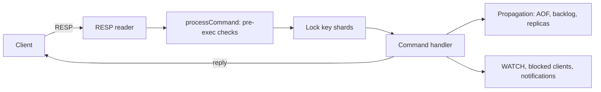
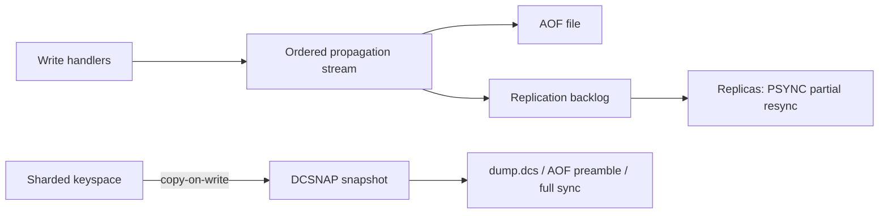

# DistCache

DistCache is a Redis-compatible in-memory server written in Go with no
dependencies outside the standard library (it ships its own Lua 5.1
interpreter for scripting). It targets Redis 8.4 command semantics and reply
formats, so existing Redis clients work unchanged. The main difference from
Redis is execution: commands run concurrently on all cores against a sharded
keyspace instead of on a single thread. Linux and macOS are the supported
platforms; Windows compiles but is not tested.

## Status

| Area | Status |
|---|---|
| Strings, bitmaps, lists, hashes (incl. field TTL, `HGETDEL`/`HGETEX`/`HSETEX`), sets, sorted sets, streams, geo, HyperLogLog | implemented |
| Transactions (`MULTI`/`EXEC`/`WATCH`), pub/sub (incl. sharded), keyspace notifications, `MONITOR` | implemented |
| Lua scripting (`EVAL`, `EVALSHA`, `SCRIPT`) and functions (`FUNCTION`, `FCALL`) | implemented |
| RESP2 and RESP3 (`HELLO`), client-side `CLIENT` commands | implemented |
| Persistence: snapshots (`SAVE`/`BGSAVE`), AOF with snapshot preamble, `BGREWRITEAOF` | implemented |
| Replication: master to replica with partial resync (`PSYNC`), `WAIT`/`WAITAOF` | implemented |
| Eviction: LRU, LFU, random and TTL policies under `maxmemory` | implemented |
| ACL | partial: single `default` user backed by `requirepass` |
| `LATENCY`, `DEBUG`, `MODULE` | partial: canned replies |
| Automatic AOF rewrite, multi-part AOF, `min-replicas-to-write` | planned |
| Cluster mode (Redis Cluster client contract), TLS, full ACL users | planned |
| Redis 8 module types (JSON, query engine, time series, probabilistic, vector sets) | planned |

Known differences from Redis 8.4 are tracked as tests: intentional ones in
`testutil.KnownDivergences`
([internal/testutil/differential.go](internal/testutil/differential.go)),
open bugs as skipped tests in
[internal/server/redis84_divergence_test.go](internal/server/redis84_divergence_test.go).

## Quick start

Requires Go 1.27.

```sh
go run ./cmd/distcache-server --port 6379
redis-cli -p 6379 SET greeting hello
redis-cli -p 6379 GET greeting
```

Build binaries into `bin/` with `make build`, or run in Docker:

```sh
make docker                       # builds distcache:dev
docker run --rm -p 6379:6379 distcache:dev
```

## Configuration

DistCache reads redis.conf-style files and redis-server-style flags; flags
override the file:

```sh
go run ./cmd/distcache-server /path/to/distcache.conf --maxmemory 2gb --appendonly yes
```

Defaults: port 6379, snapshot file `dump.dcs`, AOF file `appendonly.aof`,
256 keyspace shards (`--shards`, a power of two). `CONFIG GET *` lists every
supported parameter; `CONFIG SET` and `CONFIG REWRITE` work as in Redis.
redis.conf directives DistCache does not implement are accepted and ignored.

## Architecture

Each connection has its own goroutine. A command is parsed, checked the way
Redis checks it (arity, auth, `MULTI` queueing, OOM, read-only replica...),
then executed under the locks of exactly the shards its keys hash to.
Multi-key commands lock shards in ascending order; `MULTI`/`EXEC` and scripts
hold their locks for their whole duration, so they stay atomic.



Write effects are serialized into one ordered stream that feeds the AOF, the
replication backlog and connected replicas. Snapshots are copy-on-write and
point-in-time, so `BGSAVE` does not stop writers.



## Compatibility

- Protocol: RESP2 and RESP3.
- Replies and error texts follow Redis 8.4; a differential test suite runs
  the same scripts against DistCache and a real `redis-server` 8.4 and fails on
  any difference not on the allowlist.
- On-disk format: snapshots, `DUMP` payloads and full-sync transfers use
  DistCache's own `DCSNAP` format, which is **not** RDB-compatible.

## Performance

`make bench` builds `bin/distcache-bench` (redis-benchmark-style flags) and
runs a fixed matrix against DistCache and, if `redis-server` is on `PATH`,
Redis on the same machine. Results are written to
[bench/results/](bench/results/); see its README for the matrix. The first
measured comparison is
[bench/results/2026-11-05-docker-linux-arm64-m1.md](bench/results/2026-11-05-docker-linux-arm64-m1.md).

Honest summary of today's baseline (8 vCPUs, load tool on the same VM):
unpipelined, DistCache is 1.2–1.6x Redis for most tests but about half of
Redis for `ZADD`; with `-P 16` and 50 clients strings are faster but writes to
one hot set/hash/sorted-set key are about half of Redis; with `-P 16` and 500
clients DistCache is slower than Redis on every test (0.3–0.8x). Concurrency
only helps when commands touch different shards, and the shared hot spots on
the write path cap pipelined throughput. Removing them is the next
sub-project.

`make microbench` runs Go microbenchmarks for dispatch, RESP parsing and the
keyspace ([bench/results/microbench-baseline.txt](bench/results/microbench-baseline.txt)).

## Testing

```sh
make test        # go test -race ./... (unit + integration)
make test-e2e    # test/e2e: go-redis client, persistence, replication, resilience
make test-all    # both
make lint        # golangci-lint
make cover       # coverage.out and coverage.html
```

The differential tests need a Redis 8.4 server: either `redis-server` on
`PATH` (started per test) or an existing one via
`REDIS_SERVER_ADDR=host:port` (for example `docker run -p 6391:6379 redis:8.4`).
Without one they still run every step on DistCache and then skip. Set
`DISTCACHE_SKIP_REDIS=1` to never start a local `redis-server`.

## Project layout

```
cmd/distcache-server   server entry point (cmd/server is a compatibility copy)
cmd/distcache-bench    load generator
internal/server        connections, dispatch, command handlers, persistence, replication, scripting
internal/storage       sharded keyspace, expiry, eviction, snapshot codec
internal/ds            list, hash, set, sorted set, stream, HLL, geo, glob
internal/resp          RESP2/RESP3 reader and writer
internal/lua           Lua 5.1 interpreter
internal/config        redis.conf parsing and live CONFIG parameters
internal/testutil      in-process server, Redis differential harness
test/e2e               end-to-end tests (separate module; uses go-redis)
bench                  load-test script and results
```

## Roadmap

1. Test harness and baseline (this release).
2. Single-node throughput: remove shared hot spots so DistCache beats Redis on the same machine.
3. Cluster mode compatible with Redis Cluster clients.
4. Production hardening: ACL users, automatic AOF rewrite, `min-replicas`, `FAILOVER`, TLS.
5. Client examples (Go, Java, Python, Node) and a browser gateway.
6. Technical guides for each subsystem.

Details: [docs/superpowers/specs/2026-11-04-distcache-roadmap-and-test-harness-design.md](docs/superpowers/specs/2026-11-04-distcache-roadmap-and-test-harness-design.md).

## Credits

- [Redis](https://github.com/redis/redis), the reference implementation whose behaviour DistCache follows.
- [This video](https://www.youtube.com/watch?v=sRXIRikME14&t=178s): inspiration and background.

## License

GNU General Public License v3.0; see [LICENSE](LICENSE).
