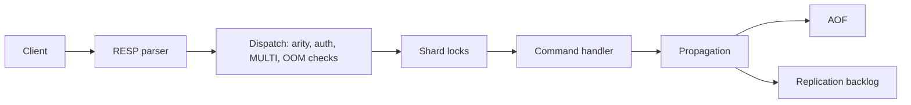
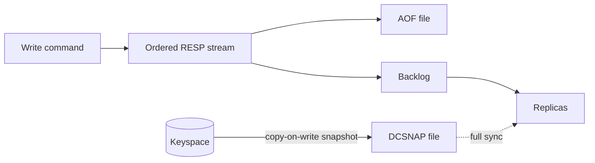

# DistCache

DistCache is a Redis-compatible in-memory server written in Go. It targets Redis 8.4 command semantics and replies, uses only the Go standard library (including its own Lua 5.1 interpreter), and runs on Linux and macOS (Windows is deferred). Unlike Redis, which executes commands on one thread, DistCache executes them concurrently across a sharded keyspace so a single node can use every core. Any Redis client should work unchanged.

## Status

| Area | Status |
|---|---|
| Strings, lists, hashes (incl. field TTL), sets, sorted sets, streams, bitmaps, HyperLogLog, geo | Implemented (247 commands registered) |
| RESP2 and RESP3, pipelining, pub/sub, sharded pub/sub, MULTI/EXEC/WATCH, blocking commands | Implemented |
| Lua scripting (EVAL, EVALSHA, SCRIPT) and FUNCTIONs on a built-in Lua 5.1 interpreter | Implemented |
| TTL, eviction (LRU, LFU, random, TTL), keyspace notifications | Implemented |
| Persistence: snapshots (SAVE/BGSAVE) and AOF | Implemented, custom format (not RDB) |
| Replication with PSYNC-style partial resync, WAIT, WAITAOF | Implemented |
| ACL | Partial: a single `default` user backed by `requirepass` |
| LATENCY, DEBUG, MODULE | Partial: canned replies |
| Automatic AOF rewrite, `min-replicas-to-write` | Planned |
| Redis 8.x additions (vector sets, JSON, Query Engine, time series, probabilistic types) | Planned, except HGETDEL/HGETEX/HSETEX which exist |
| Redis Cluster-compatible cluster mode, FAILOVER | Planned |
| TLS | Planned |
| Prometheus metrics endpoint, web console | Planned (console is roadmap item 7) |

## Quick start

Requires Go 1.27.

```sh
make build
./bin/distcache-server --port 6380 --dir /tmp/distcache
```

Or run without building:

```sh
go run ./cmd/distcache-server --port 6380
```

Talk to it with any Redis client, for example `redis-cli`:

```sh
redis-cli -p 6380 PING
redis-cli -p 6380 SET name mehedi
redis-cli -p 6380 GET name
```

Docker (the image listens on 6379 and stores data in `/data`):

```sh
make docker
docker run --rm -p 6379:6379 distcache:dev
```

Client examples in Go, Java, Python and Node are in [examples/README.md](examples/README.md). A walkthrough for poking at the server by hand is in [docs/guides/01-manual-testing.md](docs/guides/01-manual-testing.md).

## Configuration

Configuration uses redis.conf syntax and redis-server-style flags:

```sh
./bin/distcache-server /path/to/distcache.conf --maxmemory 2gb --appendonly yes
```

Defaults: port 6379, snapshot file `dump.dcs`, AOF `appendonly.aof`, 256 shards (`--shards`, power of two). Settings are live: `CONFIG GET *` lists every supported parameter, and `CONFIG SET` / `CONFIG REWRITE` work. Unsupported redis.conf directives are accepted and ignored. The legacy `-listenAddr host:port` flag still works.

## Architecture

Request path (one goroutine per connection):



Persistence and replication share one ordered stream of write effects:



Commands lock only the shards their keys hash to (in ascending order), so commands on different keys run in parallel. MULTI/EXEC and scripts hold their locks for their whole duration. The full design, including blocking commands, durability and replication, is in [docs/architecture.md](docs/architecture.md).

## Compatibility

DistCache speaks RESP2 and RESP3 and is compared reply-for-reply against a real Redis 8.4 in differential tests. Intentional differences are listed in `testutil.KnownDivergences` ([internal/testutil/differential.go](internal/testutil/differential.go)); bugs found so far are tracked in [internal/server/redis84_divergence_test.go](internal/server/redis84_divergence_test.go). `INFO` currently reports `redis_version` 7.4.0. The DCSNAP snapshot format is not RDB: RDB files and DUMP payloads are not interchangeable with Redis.

## Performance

```sh
make bench        # DistCache vs redis-server (if on PATH), see scripts/bench.sh
make microbench   # Go micro-benchmarks
```

Results: [bench/results/2026-11-05-docker-linux-arm64-m1.md](bench/results/2026-11-05-docker-linux-arm64-m1.md) (server comparison) and [bench/results/microbench-baseline.txt](bench/results/microbench-baseline.txt). Read them with care: they come from a single run inside a Docker VM on an Apple M1, with the load tool sharing the CPUs. DistCache is ahead of Redis on most commands there, but behind on some, for example ZADD at roughly half of Redis. High throughput needs many clients or pipelining; one synchronous client is bound by round-trip latency, not by the server.

## Testing

```sh
make test       # unit and integration tests with -race
make test-e2e   # end-to-end tests (separate module in test/e2e)
make test-all
```

Differential tests start a real `redis-server` if one is on PATH; set `DISTCACHE_SKIP_REDIS=1` to skip them. `internal/testutil` boots in-process servers for tests.

## Project layout

```
cmd/            distcache-server, distcache-bench
internal/       config, logger, resp, server, storage, ds, lua, testutil
examples/       client examples (Go, Java, Python, Node)
web/console/    planned web console
test/e2e/       end-to-end tests (own Go module)
deploy/docker/  Dockerfile
scripts/        bench.sh
bench/results/  benchmark results
docs/           architecture, guides, specs
```

## Roadmap

Seven sub-projects, described in [the roadmap spec](docs/superpowers/specs/2026-11-04-distcache-roadmap-and-test-harness-design.md):

1. Test harness, baseline and README (this work)
2. Single-node throughput, including a Unix domain socket listener
3. Redis Cluster-compatible cluster mode
4. Hardening: ACL, automatic AOF rewrite, TLS, FAILOVER, gating DEBUG
5. Client examples and a WebSocket gateway for browsers
6. Numbered technical guides
7. Built-in authenticated web console (React, embedded in the server binary)

## Credits

- [Redis](https://github.com/redis/redis): the reference implementation for behavior and protocol.
- https://www.youtube.com/watch?v=sRXIRikME14&t=178s: inspiration and background.

## License

GNU GPL v3, see [LICENSE](LICENSE).
