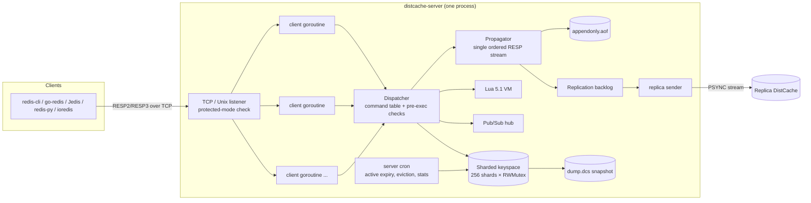
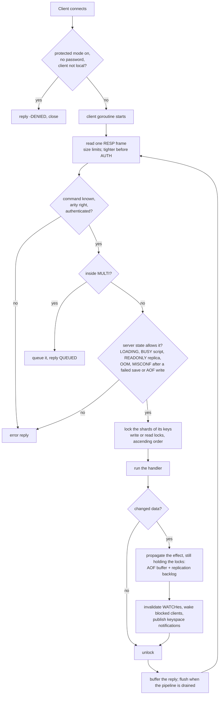
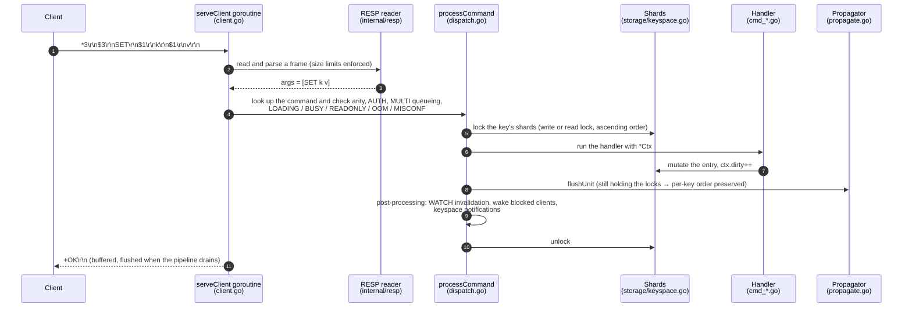
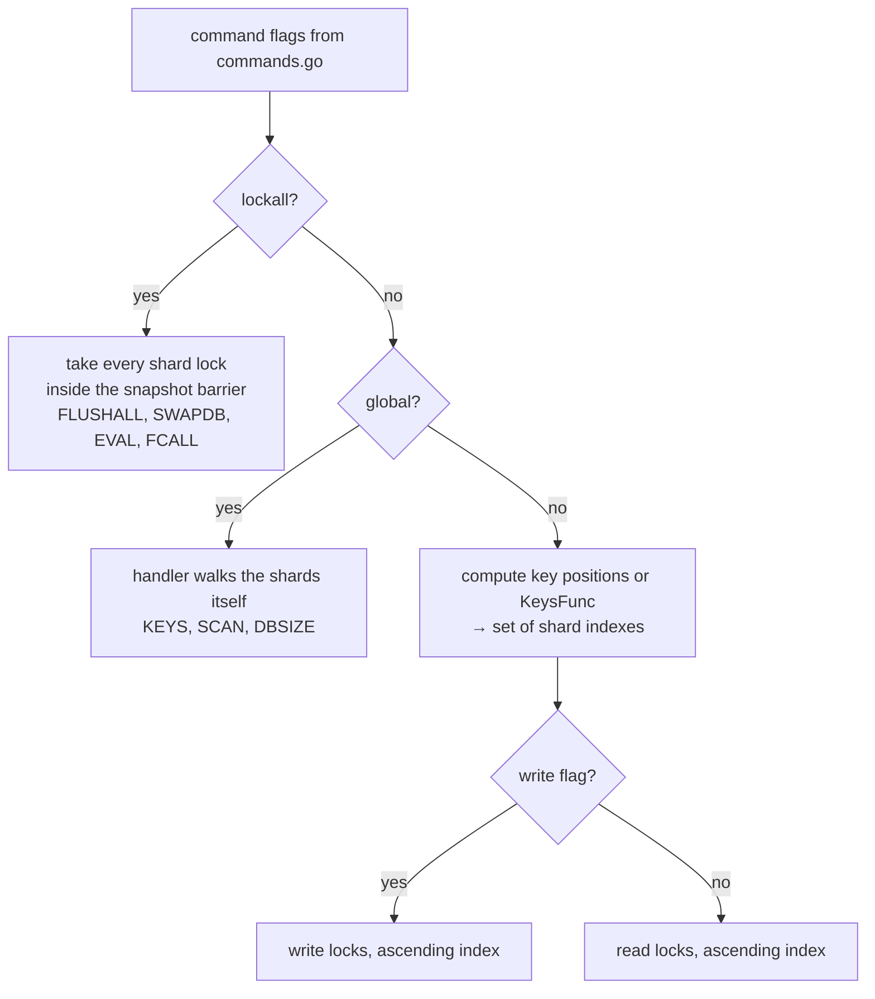
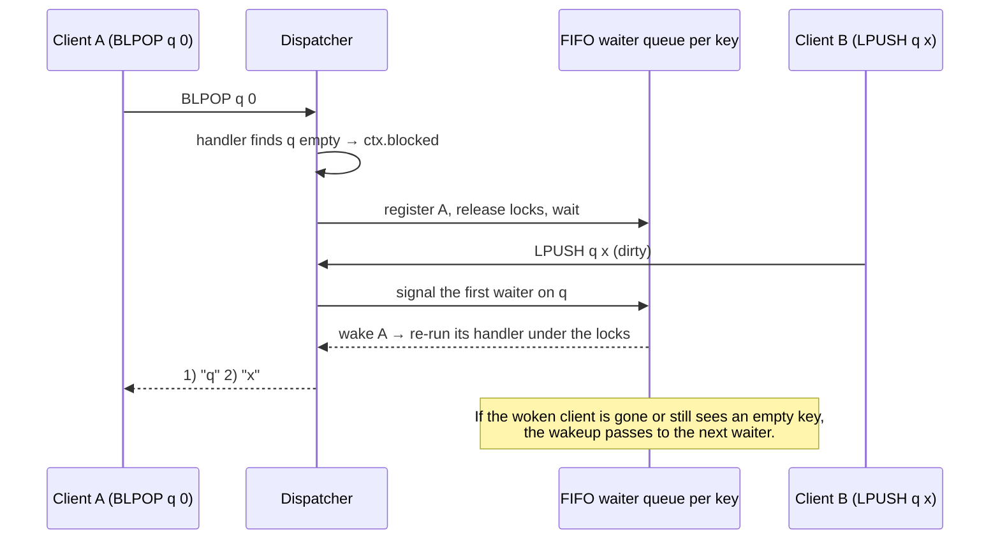
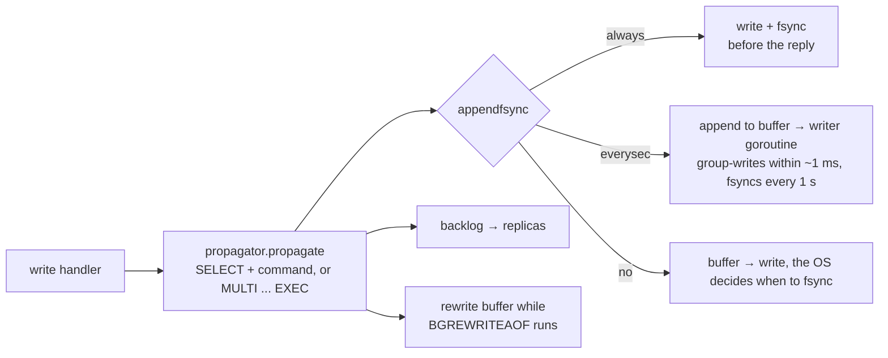
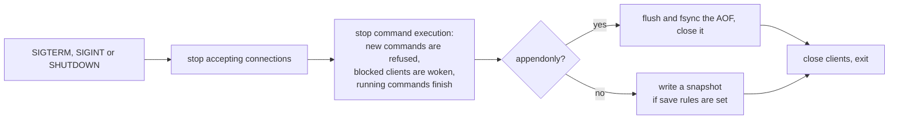
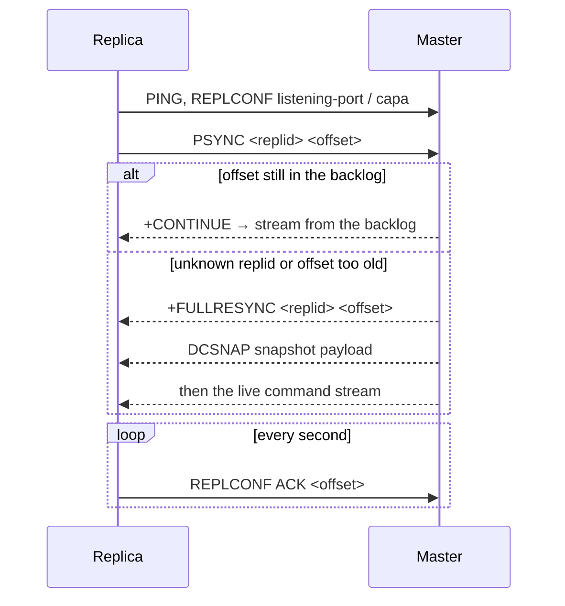

# DistCache system design

This document describes how DistCache works today, from the TCP socket to the
disk and the replicas. The diagrams are written in Mermaid, so GitHub renders them inline.

## 1. The big picture

**The key idea:** Redis runs every command on one thread. DistCache gives each
connection its own goroutine and splits the keyspace into shards. Commands that
touch different shards run in parallel on all CPU cores. Commands on the same
shard are serialized by that shard's lock.

## 2. Request lifecycle

### End to end: what happens to one command

The same path serves commands replayed from the AOF at startup, commands
arriving from a primary, and commands sent by the web console through an
in-process session. Those internal clients are already authenticated, and the
first two also skip the state checks.

### One write in detail

### How the lock mode is chosen

`EXEC` locks the union of the shards its queued commands need (every shard
if one of them needs them all), including
keys that a command names through a subcommand (`MEMORY USAGE key`,
`OBJECT ENCODING key`), and holds them until the last command has run.

A wrong key specification in the command table means a command touches data
without holding its lock. Each entry in `commands.go` therefore deserves the
same care as the handler code.

## 3. Blocking commands (BLPOP, BLMOVE, XREAD BLOCK, ...)

## 4. Durability

| Mechanism | File | When it is used |
|---|---|---|
| Snapshot (`DCSNAP` binary, not RDB) | `dump.dcs` | `SAVE`, `BGSAVE`, the AOF rewrite preamble, replica full sync, `DUMP`/`RESTORE` |
| Append-only file | `appendonly.aof` | Every write, if `appendonly yes` |
| Startup | — | Load the AOF if it is enabled, otherwise the snapshot |

On startup a cut or half-written tail of the AOF (the usual result of a
crash) is truncated at the end of the last complete command or
`MULTI`…`EXEC` block, and loading continues. If writing or syncing the AOF
fails while the server runs, writes are refused with `MISCONF` until the log
can be written again.

`BGSAVE` takes a copy-on-write snapshot. While it runs, every write handler
calls `DB.Preserve(key)` before it changes a key, so the snapshot still sees
the old value. Commands that take every shard lock (`lockall`) wait at the
snapshot barrier.

## 5. Shutdown

Execution stops before anything is saved. That order guarantees that a write
which received a success reply is in the snapshot or the AOF.

## 6. Replication

Commands that arrive from the master skip the rejection checks, ignore expiry
(the master sends a `DEL` when a key expires), and are not propagated again.
Commands whose result depends on the clock or on chance are propagated as
their effect, not as typed: `EXPIRE` becomes an absolute `PEXPIREAT`, `SPOP`
becomes `SREM`, `XCLAIM` and `XAUTOCLAIM` become one forced `XCLAIM` per
entry with its delivery time and count, and a script becomes the commands it
ran. A replica with `appendonly yes` rewrites its own AOF from the snapshot
after a full sync.

Known gaps: the snapshot does not store the replication ID and offset, so a
restarted replica always does a full resync (B27), and there is no automatic
failover.

## 7. Security boundaries

| Boundary | Mechanism |
|---|---|
| Who may connect | `bind`; protected mode refuses non-local clients while no password is set |
| Who may run commands | `requirepass` + `AUTH`; before `AUTH` a command may have at most 10 arguments of 16 KiB |
| Dangerous commands | `DEBUG` needs `enable-debug-command`; `rename-command X ""` disables any command |
| Where files go | `dir` and `dbfilename` cannot be changed at runtime unless `enable-protected-configs` allows it |
| Scripts | Read-only globals and library tables, bounded recursion, `BUSY` after `lua-time-limit` |
| Hostile input | Bulk lengths and snapshot/`RESTORE` payload lengths are never trusted for allocation |

There is no TLS on the Redis port and there are no per-user permissions yet.

## 8. Web console

`internal/web` holds a built-in console: login against `requirepass`, a live
dashboard fed by server-sent events, and a command console. It talks to the
server through an in-process session (`server.Session`), so its commands
take the same path as any client's. The package is complete enough to test
but `distcache-server` does not start it yet; the key browser, the Pub/Sub
page and the start-up switch (`web-port`) are the remaining tasks. The design
is in [superpowers/specs/2026-11-10-web-console-design.md](superpowers/specs/2026-11-10-web-console-design.md).

## 9. Code map

| Layer | Package / file |
|---|---|
| Entry points | `cmd/distcache-server`, `cmd/distcache-bench` |
| Config (live, atomics), logging | `internal/config`, `internal/logger` |
| Wire protocol | `internal/resp` |
| Connection, dispatch, commands | `internal/server` (`client.go`, `dispatch.go`, `commands.go`, `cmd_*.go`) |
| Keyspace, eviction, codec | `internal/storage` |
| Data structures | `internal/ds` (list, hash, set, zset, stream, HLL, geo, glob) |
| Scripting | `internal/lua`, `internal/server/scripting.go` |
| Test helpers | `internal/testutil`, `test/e2e` |
| Client examples | `examples/` (Go, Java, Python, Node) |
| Web console | `internal/web` (templates and static files embedded in the binary) |
| Packaging | `deploy/docker`, `deploy/kubernetes`, `deploy/systemd`, `deploy/distcache.conf`, `scripts/release.sh` |
| Benchmarks, generated docs | `scripts/bench.sh`, `scripts/bench-slow-command.sh`, `scripts/gencommands` |

## 10. Where this is heading

| # | Sub-project | Status |
|---|---|---|
| 1 | Test harness, baseline benchmarks, README | done |
| 2 | Single-node throughput: no global propagator lock, sharded counters, pooling, lock-free reads, faster sorted set | planned, next |
| 3 | Redis Cluster–compatible cluster mode (16384 slots, MOVED/ASK, its own cluster bus) | planned |
| 4 | Hardening | partly done: protected mode, protected configs, the `DEBUG` gate. Planned: ACL users, TLS, automatic AOF rewrite, `FAILOVER` |
| 5 | Client examples (Go, Java, Python, Node) and a WebSocket gateway for browsers | examples written; gateway planned |
| 6 | Numbered technical guides | Guide 1 (manual testing) and Guide 3 (deployment) written |
| 7 | Built-in web console (htmx, embedded in the binary) | 7 of 10 tasks done; not started by the server yet |

Today every write passes through one propagator mutex (`propagator.mu`). That
is the main contention point sub-project 2 removes; the numbers it has to
beat are in [benchmarks.md](benchmarks.md).
