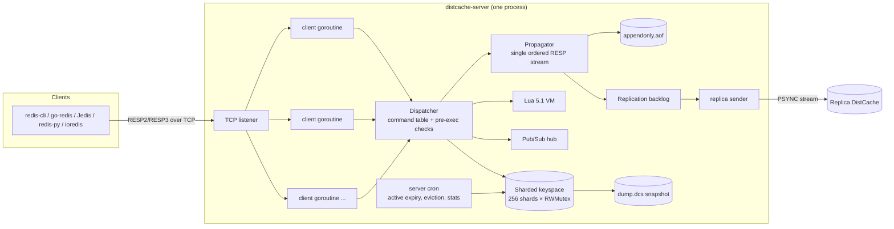
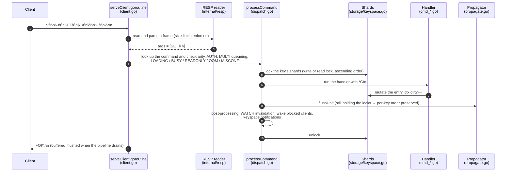
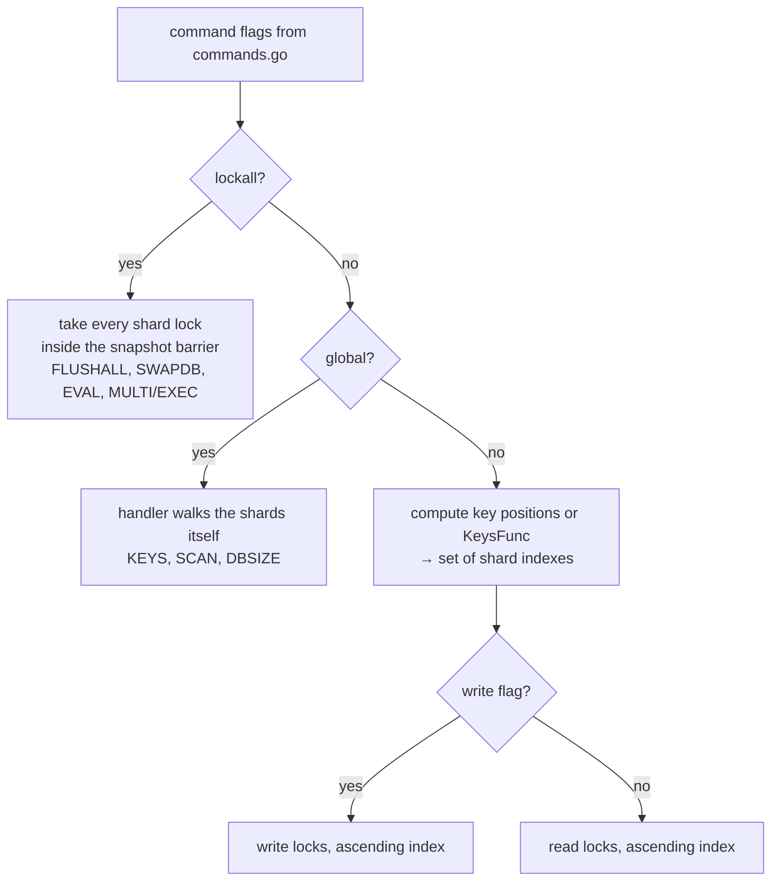
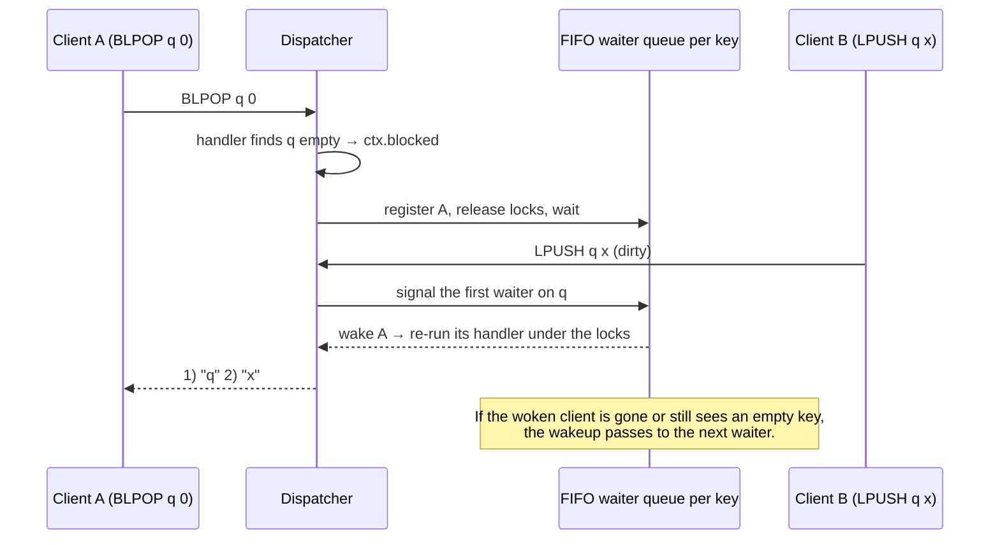
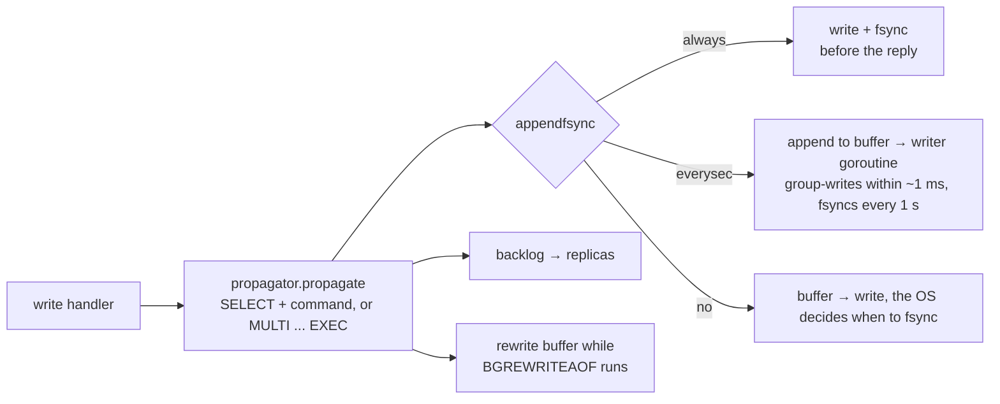
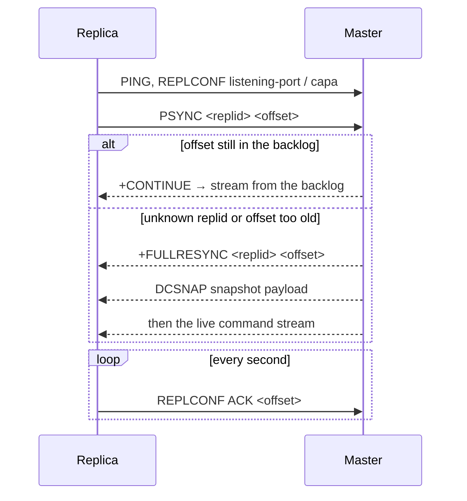

# DistCache system design

This document describes how DistCache works today, from the TCP socket to the
disk and the replicas. The diagrams are written in Mermaid, so GitHub renders them inline.

## 1. The big picture

**The key idea:** Redis runs every command on one thread. DistCache gives each
connection its own goroutine and splits the keyspace into shards. Commands that
touch different shards run in parallel on all CPU cores. Commands on the same
shard are serialized by that shard's lock.

## 2. Request lifecycle

### How the lock mode is chosen

A wrong key specification in the command table means a command touches data
without holding its lock. Each entry in `commands.go` therefore deserves the
same care as the handler code.

## 3. Blocking commands (BLPOP, BLMOVE, XREAD BLOCK, ...)

## 4. Durability

| Mechanism | File | When it is used |
|---|---|---|
| Snapshot (`DCSNAP` binary, not RDB) | `dump.dcs` | `SAVE`, `BGSAVE`, the AOF rewrite preamble, replica full sync, `DUMP`/`RESTORE` |
| Append-only file | `appendonly.aof` | Every write, if `appendonly yes` |
| Startup | — | Load the AOF if it is enabled, otherwise the snapshot |

`BGSAVE` takes a copy-on-write snapshot. While it runs, every write handler
calls `DB.Preserve(key)` before it changes a key, so the snapshot still sees
the old value. Commands that take every shard lock (`lockall`) wait at the
snapshot barrier.

## 5. Replication

Commands that arrive from the master skip the rejection checks, ignore expiry
(the master sends a `DEL` when a key expires), and are not propagated again.
Known gap (B27): the snapshot does not store the replication ID and offset,
so a restarted replica always does a full resync.

## 6. Code map

| Layer | Package / file |
|---|---|
| Entry points | `cmd/distcache-server`, `cmd/distcache-bench` |
| Config (live, atomics), logging | `internal/config`, `internal/logger` |
| Wire protocol | `internal/resp` |
| Connection, dispatch, commands | `internal/server` (`client.go`, `dispatch.go`, `commands.go`, `cmd_*.go`) |
| Keyspace, eviction, codec | `internal/storage` |
| Data structures | `internal/ds` (list, hash, set, zset, stream, HLL, geo, glob) |
| Scripting | `internal/lua`, `internal/server/scripting.go` |
| Test helpers | `internal/testutil`, `test/e2e` |
| Client examples | `examples/` (Go, Java, Python, Node) |
| Web console (planned) | `web/console` |
| Deployment, scripts | `deploy/docker`, `scripts/bench.sh` |

## 7. Where this is heading

| # | Sub-project | Status |
|---|---|---|
| 1 | Test harness, baseline benchmarks, README | in progress |
| 2 | Single-node throughput: no global propagator lock, sharded counters, pooling, lock-free reads | planned |
| 3 | Redis Cluster–compatible cluster mode (16384 slots, MOVED/ASK, its own cluster bus) | planned |
| 4 | Hardening: ACL, automatic AOF rewrite, TLS, FAILOVER, gating `DEBUG` | planned |
| 5 | Client examples (Go, Java, Python, Node/TS) and an HTTP/WebSocket gateway | planned |
| 6 | Numbered technical guides | planned (this is Guide 1) |
| 7 | React web console: browse keys, view live metrics, visualise data | planned |

Today every write passes through one propagator mutex (`propagator.mu`). That is the
main contention point sub-project 2 removes.
