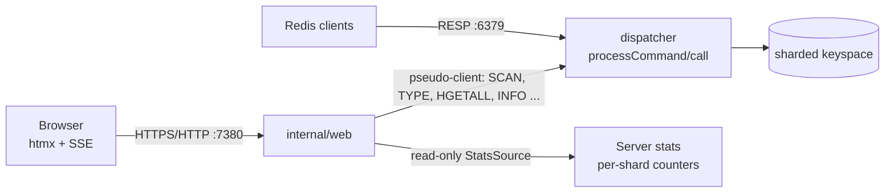

# DistCache built-in web console — design (sub-project 7)

Date: 2026-11-10 · Status: approved in conversation, pending written-spec review

## 1. Goal

A web console built into `distcache-server` so a small team can watch live server
stats and browse every key and value through a secure, authenticated browser UI.
It should present data better than RedisInsight does. Phase A ships the dashboard, the
key browser and the command console. Phase B adds Redis-compatible ACL users
and roles, editing, and the server pages.

### Agreed with the user
- Built-in to the server binary; nothing extra to install. htmx + Go `html/template`,
  black theme (#0a0a0c) with the logo's cyan→violet (#22d3ee → #a78bfa) accents.
- Audience: a small team on a shared server (several users, viewer/admin roles,
  audit log, TLS when remote), designed so internet-facing hardening can follow.
- Users: one user system. Phase A logs in the `default` user via `requirepass`
  (admin). Phase B adds Redis-compatible ACL (`ACL SETUSER`, `AUTH user pass`,
  `user ...` lines in distcache.conf and `aclfile`). Console roles come from ACL permissions.
- Data access: approach A, an in-process pseudo-client through the normal dispatcher.
- Port 7380 (avoids 6380 replica, 7000–7005 cluster, 7379 Webdis, 16379 cluster bus).
- TLS configurable: `auto` (default), `on`, `off`, plus an auto-generated self-signed cert and reverse-proxy mode.

### Constraints
- Stdlib only. The one exception is a pinned, embedded copy of `htmx.min.js` (2.0.x, BSD-0), which ships as a static asset and is not a Go dependency.
- The console can never take DistCache down: a web failure is logged, and the RESP server keeps running.
- RESP behaviour on 6379 is unchanged.

## 2. Architecture

```
internal/web/
  server.go      listener, routing, middleware chain (headers → session → CSRF → handler)
  tls.go         TLS mode resolution, self-signed cert generation/persistence
  auth.go        login/logout, sessions, lockout, CSRF tokens
  console.go     executes commands as an internal client through the dispatcher
  dashboard.go   stats sampling (1 s), ring buffer (300 samples), SSE stream
  keys.go        SCAN paging and per-type viewers
  render.go      RESP value → HTML view models (tables, charts, timeline, hex)
  templates/     *.html (layout, login, dashboard, keys, key, console, partials)
  static/        htmx.min.js, htmx-sse.js, app.css, logo-mark.svg (go:embed)
```



- **Pseudo-client.** `server.NewInternalClient(user string)` returns a `*Client`
  with no socket. `Exec(args [][]byte) (resp.Value, error)` runs the command through
  `processCommand`, so it passes ACL/auth, LOADING/BUSY/OOM checks and locking, and shows up in
  MONITOR, the slow log and stats. Each browser session gets its own internal client, so
  per-session SELECT works.
- **StatsSource.** This is a read-only interface exported by `internal/server` for metrics that
  RESP cannot express:
  - `ShardStats() []ShardStat`, with keys, ops and lock-wait nanoseconds per shard;
  - `CommandStats()`;
  - `Snapshot()`, which returns the same counters INFO reads.
  
  The interface is atomic-based and takes no shard locks.
- **Startup.** `distcache-server` calls `web.Start(srv, cfg)` only when `web-port > 0`.
  A bind or TLS error is logged, and the server keeps running.

## 3. Features

### Phase A
- **Dashboard**
  - Tiles: ops/s, p50/p99 latency, used memory vs maxmemory, connected clients, hit rate, evictions, expired keys and replication role.
  - 5-minute sparklines.
  - A **shard heatmap** showing ops and lock-wait per shard, refreshed by SSE every 1 s.
- **Key browser**
  - Pattern search driven by a SCAN cursor, with COUNT 200 and a "load more" button; it never runs `KEYS`.
  - A type filter (SCAN TYPE) and columns for key, type, TTL and MEMORY USAGE.
  - Per-type viewers, each paged so a huge key is never loaded at once:
    - string: text, JSON pretty-print, or hex for binary;
    - hash: sortable table via HSCAN;
    - list: indexed table via LRANGE pages;
    - set: table via SSCAN;
    - zset: ranked bar chart and table via ZRANGE WITHSCORES pages;
    - stream: timeline via XRANGE pages, entry fields as a table;
    - geo (zset with geo members): SVG scatter plot of GEOPOS, with no external map tiles;
    - HyperLogLog: cardinality (PFCOUNT) and encoding.
- **Console**
  - Command input with history (stored per session) and RESP-aware formatted output.
  - Blocking, streaming and connection-state commands are refused with an explanation:
    SUBSCRIBE*, PSUBSCRIBE, SSUBSCRIBE, MONITOR, B* blocking commands with timeout 0,
    and CLIENT REPLY/QUIT/RESET.

- **Interactive console extras** (added 2026-11-10):
  - a sample-command panel per data type;
  - a "Load sample data" seed;
  - command autocomplete with syntax hints from COMMAND DOCS;
  - keyboard history.
- **Pub/Sub page** (moved from phase B, 2026-11-10):
  - publish form;
  - live SUBSCRIBE/PSUBSCRIBE over SSE on a dedicated internal session;
  - active channels with subscriber counts.

- **Memory limit control** (added 2026-11-10): the dashboard memory tile edits `maxmemory` (such as 4gb) and `maxmemory-policy` per node via CONFIG SET, with CSRF and an audit line. This is the only editing control in phase A.

### Phase B
- ACL users and roles. A `+@all` user is admin; a user without `+@write` is viewer, which hides edit controls. The server still enforces permissions, so hiding is only cosmetic.
- Editing: create, edit and delete keys and change TTLs. Each change needs a confirmation step, and FLUSHDB/FLUSHALL need the database name typed in.
- Server pages: CONFIG view/set, CLIENT LIST/KILL, SLOWLOG, replication, and a live MONITOR stream over SSE.
- Value masking for configured key patterns (`web-mask-patterns`).

## 4. Security
- **Login**
  - Phase A checks the `default` user's password against `requirepass`, in constant time.
  - If no `requirepass` is set, the console refuses to start unless `web-insecure yes` is given.
- **Session**
  - A 256-bit `crypto/rand` token, stored server-side in a map, with idle timeout `web-session-timeout` (30m) and a 12h absolute limit.
  - Cookie `dc_session` with `HttpOnly`, `SameSite=Strict`, `Path=/`, and `Secure` whenever the browser connection is HTTPS (direct or via a trusted proxy).
  - Logout and timeout delete the session and its internal client.
- **CSRF**
  - A per-session token is required on every POST, as a header (`HX-Request` and `X-CSRF-Token`) or a form field. GET handlers never change state.
- **Lockout**
  - 5 failed logins per client IP within 5 minutes locks that IP out for 5 minutes. The client IP comes from `X-Forwarded-For` only when the peer is a `web-trusted-proxy`.
- **Headers** on every response:
  - `Content-Security-Policy: default-src 'self'; script-src 'self'; style-src 'self'; img-src 'self' data:; frame-ancestors 'none'`
  - `X-Content-Type-Options: nosniff`, `Referrer-Policy: no-referrer`
  - `Cache-Control: no-store` on data pages
- **Escaping**
  - All values are rendered through `html/template`.
  - Binary values are shown as hex.
  - No value is ever placed in an attribute without escaping, and none is placed in a script context.
- **Audit**
  - Every console command and every login success or failure is logged at info level as `web` with user, IP, command name and key count.
  - Argument values are never logged.

## 5. TLS and networking

| `web-tls` | bind is loopback | bind is non-loopback |
|---|---|---|
| `auto` (default) | HTTP | HTTPS with `web-tls-cert`/`web-tls-key` if set, otherwise an auto self-signed cert |
| `on` | HTTPS (provided or self-signed) | same |
| `off` | HTTP | refused unless `web-trusted-proxy` or `web-insecure yes` is set |

- **Self-signed cert**
  - ECDSA P-256, valid for 1 year.
  - SANs: localhost, hostname, the bind IP, and `web-tls-hosts`.
  - Saved as `<dir>/web-cert.pem` and `<dir>/web-key.pem` with mode 0600, and reused on restart.
  - Regenerated 30 days before expiry.
  - The SHA-256 fingerprint is logged at startup.
- **Insecure mode**
  - `web-insecure yes` logs a warning every 10 minutes and shows a red banner in the UI.
- **TLS settings**
  - Minimum TLS 1.2, with Go's default cipher suites.

## 6. Configuration

All settings live in distcache.conf, can be given as `--name value`, and are readable via CONFIG GET. They are static, so a change needs a restart.

| name | default | notes |
|---|---|---|
| `web-port` | 0 (off) | 7380 is the documented port |
| `web-bind` | 127.0.0.1 | |
| `web-tls` | auto | auto, on, off |
| `web-tls-cert`, `web-tls-key` | "" | PEM paths |
| `web-tls-hosts` | "" | extra SANs for the self-signed cert, comma-separated |
| `web-trusted-proxy` | "" | comma-separated IPs/CIDRs |
| `web-insecure` | no | |
| `web-session-timeout` | 30m | |
| `web-mask-patterns` | "" | phase B |

## 7. Errors
- The web listener fails to bind or TLS setup fails: the error is logged, the console is disabled, and the RESP server is unaffected.
- A command error is shown inline as a styled error reply.
- A lost SSE connection reconnects automatically through htmx-sse with backoff.
- Every handler recovers panics into a 500 page and logs them; a panic never crashes the process.

## 8. Testing
- **Unit tests** (`httptest`):
  - login success and failure; lockout after 5 failures and reset after the window;
  - session idle and absolute expiry;
  - CSRF missing or invalid → 403;
  - security headers present;
  - a hostile value such as `<script>alert(1)</script>` in a key name and value renders escaped;
  - binary values render as hex;
  - console refuses SUBSCRIBE/MONITOR;
  - TLS mode table (each row);
  - self-signed cert persisted with 0600 and reused.
- **Integration**
  - Boot `testutil.StartServer` with web on a random port and log in.
  - The dashboard SSE emits a sample within 2 s.
  - Key browser pages through 1,000 keys.
  - Each type viewer renders a seeded key.
  - `requirepass` unset → console refuses to start.
- **E2E** (`test/e2e`): start the binary with `--web-port`, then curl login → dashboard → key.
- **Browser**: a Playwright smoke check of each page (manual or CI-optional).

## 9. Out of scope
Internet-facing extras: 2FA, OAuth/SSO, Let's Encrypt (use a reverse proxy instead). Also out of scope: multi-node or cluster views (these come with sub-project 3), and the WebSocket gateway for apps (sub-project 5).
